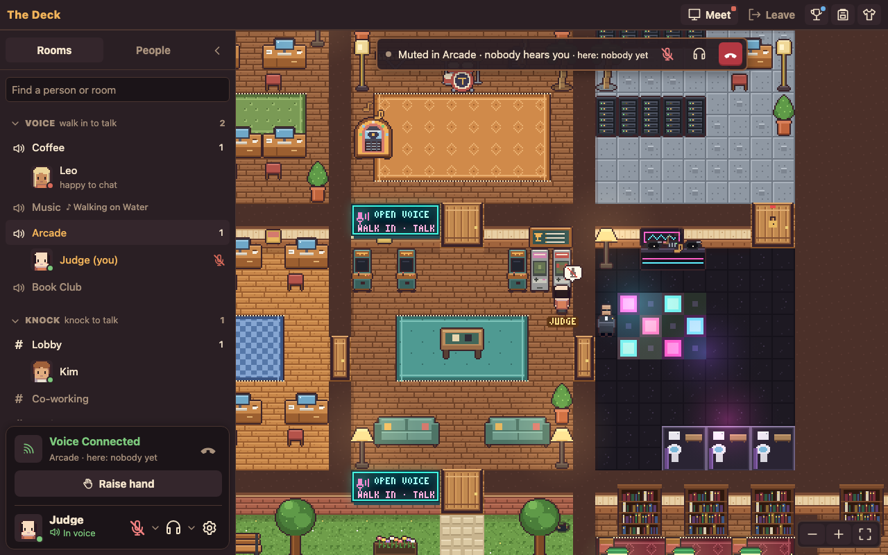

# The Deck

A cozy pixel-art virtual office for T1A, a fully remote team of about 30 people. Everyone is a little character on
one shared floor. You see who is around at a glance, walk over to a colleague and knock to talk, or drop into an open
room where people are already chatting. It runs in the browser and as a macOS menu bar app.

Live: https://voffice.t1a.io (T1A, NetBird sign-in) and the hackathon demo at https://voffice-demo.pub.t1a.cloud
(sign in by typing any email).



## Hackathon entry

| | |
| --- | --- |
| Event | T1A Hackathon: Cyprus Odyssey, Fall 2026. Coding window Oct 15–16, 2026 |
| Team | The Suitors: Andrii Butko (captain), Ivan Baranov, Varya Tikhonova |
| Category | Inside the Crew: collaboration inside T1A |
| Kickoff token | `ODYSSEY-2026-UNLEASH-THE-GODS`, in the first commit `b1e24ad` (Oct 15, 11:16 CEST; kickoff was 10:00 CEST) |
| Pre-built work | None. All code was written in the coding window; third-party code and assets are listed under [Credits and licences](#credits-and-licences) |
| Build log | [docs/BUILD-LOG.md](docs/BUILD-LOG.md): what landed when, who built what, and how we worked |
| Client data | None. The app only uses T1A's own accounts and calendars |

## The problem

A remote company loses the office's ambient awareness. You can't see who is around, who is deep in focus and who is
free for a quick question, so every question becomes a scheduled call or a Slack message that waits. Video tools only
show people once a meeting has started. Chat status dots don't say "come over".

## What we built

One floor with rooms (Lobby, Focus, Meeting, Coffee, Co-working, Desks, Studio, Music, Arcade, Library and more).
The server is the source of truth, and everyone sees the same walks, the same knocks and the same rooms.

- **Presence on a map.** Your character stands where you are working. Click to walk there (A* pathfinding, the same
  path on every client). Status text, away and "in a call" bubbles, a home desk with a plant that grows when you
  show up, local time zones on hover and on the Lobby clock.
- **Knock to talk.** Click someone and knock. They get Accept / Later, and Accept starts built-in voice (WebRTC, audio
  only, up to 5 people) or a Google Meet room of its own. Focus rooms block knocks. A knock during a meeting goes to a
  Later list.
- **Open voice rooms.** Walk into Coffee, Music, the Arcade or the Book Club and you are in the room's conversation,
  like a Discord voice channel. Sound fades with distance and is muffled by walls and doors.
- **Calendar-aware.** Connect Google and a wall calendar shows your week. Before a meeting you get a heads-up with
  **Go**, which takes you into a private copy of the Meeting room that only the other guests can enter. People on
  vacation in Google Calendar walk the beach and the mountains instead of sitting at their desk.
- **Places to be together.** A shared jukebox with a CC0 music library and a Lofi Girl TV, playable instruments, an
  arcade with a rollback-netcode co-op platformer and party games, a game table (chess, draughts, dominoes, Last
  Card), Game Boy homebrew cabinets, presentation mode with PDF slides and screen sharing, a library of shared
  articles, lunch tables that are small voice rooms.
- **A bit of office life.** A cat, a dog, a cleaning lady who takes away forgotten cups, hats, a reception bell, a club
  with a dance floor, a hidden dungeon.
- **Built for daily use.** A Discord-style sidebar of rooms and people, phone layout, admin edit mode for furniture,
  and a macOS menu bar app that shows knocks and unread messages, installs with one command and updates itself.

The full list, with the code behind each feature, is in [docs/FEATURES.md](docs/FEATURES.md).

## How it works

```
 Browser / Mac app (WKWebView)                          Node server (one process)
 ┌──────────────────────────────┐   WebSocket /ws      ┌──────────────────────────────────┐
 │ React chrome (App.tsx,       │ ◄──── events ──────  │ World (world.ts): users, moves,   │
 │   sidebar/, panels)          │ ───── intents ────►  │   knocks, calls, rooms, games     │
 │ Canvas engine (engine.ts)    │                      │ validates every client message    │
 │ Store + socket (net.ts)      │   REST /api          │ REST: login, Google OAuth,        │
 │ Voice: WebRTC mesh (voice.ts)│ ◄──────────────────► │   slides upload, Mac app install  │
 │ Soundscape: Web Audio        │                      │ state → data/state.json every 30s │
 └──────────────────────────────┘                      └──────────────────────────────────┘
           │   peer-to-peer audio (signaling relayed by the server)   │
           └──────────────────────── shared/ ─────────────────────────┘
              map + A* (map.ts), protocol (protocol.ts), game rules and sims
```

- **Server-authoritative, deterministic clients.** Clients send intents (`move`, `knock`, `use`, …). The server
  validates them and broadcasts events. Every client computes the same A* path from the same map, so a walk is one
  message rather than a stream of positions.
- **One protocol file.** Every WebSocket message, in both directions, is a typed union in
  [shared/protocol.ts](shared/protocol.ts).
- **The map is data.** [scripts/gen-map.mjs](scripts/gen-map.mjs) generates `shared/tilemap.json`: rooms, furniture,
  doorways and room rules (knock policy, open voice, access). Code reads the rules and doesn't hard-code rooms.
  [docs/MAP.md](docs/MAP.md) is the generated atlas.
- **Procedural art.** [scripts/gen-assets.mjs](scripts/gen-assets.mjs) draws every sprite into
  `client/public/assets/` (a sprite atlas plus PNG sheets), so there is no third-party art.
- **Games share one runner.** Arcade games are deterministic `GameDef`s in `shared/arcade/`. The server orders the
  inputs, and clients predict and roll back with `shared/arcade/runner.ts`. The game table is turn-based, and each
  player only ever receives their own hand.
- **Persistence is a JSON file.** State is saved to `data/state.json` every 30 s with a versioned dump and daily
  backups. Calls and games live in memory only.
- **Identity.** On prod a NetBird reverse proxy signs people in (`X-NetBird-User`, trusted only from the proxy's
  address, `server/src/auth.ts`). Test instances use a name-only login behind a NetBird PIN, the demo instance takes
  any email, and local dev uses a shared token.

[AGENTS.md](AGENTS.md) explains each subsystem in depth: voice, Google, meetings, jukebox, arcade, edit mode, dungeon,
creatures, presentation, Mac app.

## What works, and what doesn't yet

Works, on prod since Oct 15: everything listed above, used by the team during the hackathon in desktop browsers, on
phones and in the Mac app. 600+ automated tests cover the world rules, calls, rooms, games, game table
rules, jukebox, vacations, static serving and layout editing.

Known limits:
- Voice is a peer-to-peer mesh, so a call holds at most 5 people (open rooms allow 12 speakers). Calls and games
  don't survive a server restart.
- Google features (own Meet rooms, calendars, vacations) need OAuth credentials, so they run on prod only.
- Away detection is manual. There is no idle detection yet, so someone who walks away with the tab open still shows
  as online.
- The Mac app is self-signed. Updates must come from the same signing identity, or the mic permission is asked again.
- One process with in-memory state: fine for a 30-person company, not for thousands of people.

## What's next

- Sign-in without NetBird (email one-time code) so guests and new joiners can come in.
- Automatic away: snooze when the laptop sleeps, leave after a while.
- Slack status sync, an announcement board for HR news and birthdays, and seasonal decorations.
- TURN relay for voice on strict networks, and an SFU when calls need more than 5 people.

## How to run

Needs Node.js 22 or newer and npm.

```bash
npm ci
npm run dev
```

Open http://localhost:5173. In dev you are signed in automatically as `Dev`. Open `?as=Kim` in a second tab to be
someone else and knock on yourself. A few bots walk around so the floor isn't empty (`BOTS=0` turns them off).
The API listens on 127.0.0.1:8787, and Vite proxies `/api` and `/ws` to it.

Checks (the same three run in CI on every pull request):

```bash
npm test                  # node:test, about 45 s
npm run typecheck         # tsc, server and client
npm run build -w client   # production bundle in client/dist
```

Production-like, one process serving the built client:

```bash
npm run build -w client
npm start -w server       # http://localhost:8787, sign in with any name and the token "deck"
```

Other tools:

```bash
npm run gen               # regenerate the map, the atlas (docs/MAP.md) and the art after editing a generator
npm run where -- coffee   # where a room, object, use.kind or tile is, and every line of code that mentions it
npm run dev:mesh          # dev over HTTPS on a NordVPN Meshnet address, for testing the mic on other devices
macos/build.sh            # the menu bar app → macos/build/The Deck.app (needs Xcode Command Line Tools)
```

### Configuration

Everything is optional in dev. Instances read these from `/etc/deck-<name>.env`, which `scripts/deploy.sh` writes.

| Variable | What it does |
| --- | --- |
| `DECK_PORT`, `DECK_HOST` | Where the server listens (8787, 0.0.0.0; dev uses 127.0.0.1) |
| `DECK_TOKEN`, `TOKEN_LOGIN`, `OPEN_LOGIN`, `EMAIL_LOGIN` | Name + token login (token `deck` by default); `OPEN_LOGIN=true`: any name, no token; `EMAIL_LOGIN=true`: any email, unconfirmed (the demo) |
| `NETBIRD_AUTH`, `NETBIRD_TRUSTED_CIDR`, `NETBIRD_TRUSTED_PEER` | NetBird SSO: trust `X-NetBird-User` only from the proxy |
| `DECK_ADMINS`, `DECK_SYSADMINS` | Office admins (edit mode, GM panel) and sysadmins (the Admin room), comma-separated emails |
| `DECK_ICE_SERVERS` | WebRTC ICE servers as JSON (default: Google STUN) |
| `GOOGLE_CLIENT_ID`, `GOOGLE_CLIENT_SECRET`, `GOOGLE_TOKEN_KEY`, `GOOGLE_HD`, `GOOGLE_REDIRECT_URI` | Connect Google (Meet rooms, calendars, vacations); off without them |
| `VACATION_TEAM_CALENDAR` | The shared time-off calendar (empty disables it) |
| `DECK_PUBLIC_URL`, `DECK_INSTALL_URL` | Public URL, and the URL the Mac app installer downloads from |
| `PRESENT_USER_QUOTA_MB`, `PRESENT_TTL_HOURS` | Slide storage per person (100 MB) and how long decks are kept (24 h) |
| `BOTS`, `BOT_COUNT`, `VACATION_BOTS`, `VACATION_FAKE` | Dev bots, and fake vacations for testing (`name:days,…`) |
| `PETS`, `BAT` | `PETS=0` removes the animals and the cleaner; `BAT=1` brings out the bat outside October |
| `VITE_PORT`, `DECK_MESH`, `DECK_MESH_IP` | Dev server port, and the Meshnet HTTPS mode |

## Repository map

| Path | What is there |
| --- | --- |
| `server/src/` | Node + `ws`. `index.ts` (HTTP, login, WebSocket), `world.ts` (all office state and rules), one file per subsystem (`google.ts`, `meetings.ts`, `jukebox.ts`, `arcade.ts`, `table.ts`, `retro.ts`, `presentation.ts`, `vacations.ts`, `creatures.ts`, …) and its `*.test.ts` |
| `client/src/` | React chrome (`App.tsx`, `sidebar/`, panels) around one canvas (`engine.ts`); `net.ts` (store + socket), `voice.ts` (WebRTC), `soundscape.ts` (Web Audio); `arcade/`, `park/`, `retro/`, `table/` draw the games |
| `shared/` | Code both sides run: `map.ts` (A*, rooms, seats, `USE_KINDS`), `protocol.ts`, `acoustics.ts`, game rules and sims (`arcade/`, `park/`, `table/`, `retro/`), `tilemap.json` (generated) |
| `scripts/` | Generators (`gen-map.mjs`, `gen-assets.mjs`, `map-atlas.mjs`, `gen-music.mjs`), `where.mjs`, `deploy.sh`, `instances.txt` |
| `macos/` | The menu bar app (Swift, AppKit + WKWebView), its build and signing scripts |
| `docs/` | [FEATURES.md](docs/FEATURES.md) (feature → code), [ADDING-A-FEATURE.md](docs/ADDING-A-FEATURE.md) (where a change goes), [MAP.md](docs/MAP.md) (generated atlas), [UI.md](docs/UI.md) (UI rules), [BUILD-LOG.md](docs/BUILD-LOG.md), `docs/superpowers/specs/` (the design spec written before each bigger feature) |
| `vendor/binjgb/` | The Game Boy emulator's JavaScript glue (MIT) |

[AGENTS.md](AGENTS.md) is the guide for people and coding agents working on the code: how things work, the parts that
bite, testing tips, deploying and the merge rules. [REQUIREMENTS.md](REQUIREMENTS.md) is the product brief.

## Deploying

Several instances run side by side on one box behind NetBird (`scripts/instances.txt`): prod at
https://voffice.t1a.io, one test instance per teammate and the hackathon demo. `scripts/deploy.sh <name>` builds the client, ships the
checkout and restarts that instance's systemd service. Prod deploys only from a clean checkout of the head of `main`.
Details are in [AGENTS.md › Deploying](AGENTS.md#deploying).

## Credits and licences

The code in this repository was written by the team during the hackathon. All art is generated by
`scripts/gen-assets.mjs`, and sound effects are synthesized in the browser. Third-party pieces:

| What | Where | Licence |
| --- | --- | --- |
| binjgb Game Boy emulator, © 2016 Ben Smith | `vendor/binjgb/`, `client/public/retro/binjgb.wasm` | MIT ([vendor/binjgb/LICENSE](vendor/binjgb/LICENSE)) |
| Tobu Tobu Girl Deluxe, © 2017 Tangram Games | `client/public/retro/tobudx.gb` | Code MIT, assets CC BY 4.0 |
| Shock Lobster, © 2021 Dave VanEe | `client/public/retro/shocklobster.gb` | zlib |
| Jukebox music (21 tracks, Free Music Archive / Internet Archive) | `client/public/assets/music/` | CC0 1.0; sources per track in [scripts/music.json](scripts/music.json) |
| React, ws, Vite, tsx | npm dependencies | MIT |
| pdf.js (`pdfjs-dist`) | npm dependency | Apache 2.0 |
| chess.js | npm dependency | BSD 2-Clause |
| Lofi Girl live stream | Embedded YouTube player, not redistributed | YouTube terms |

The full licence texts for the emulator and the ROMs are in
[client/public/retro/LICENSES.md](client/public/retro/LICENSES.md).
